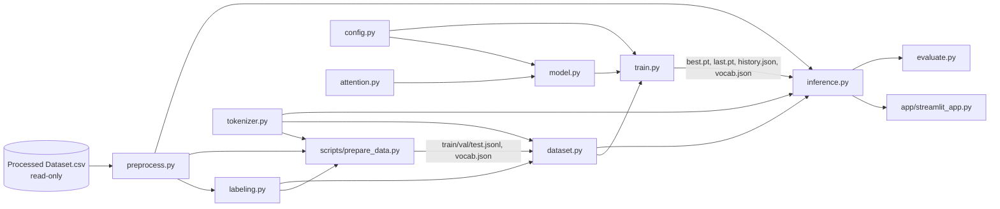

# INTERFACES — Kontrak Antar-Modul ReviewLens GPT

Status: **Revisi 2.1 — siap ditinjau untuk persetujuan tim.**
Revisi 2.1: target padding memakai `IGNORE_INDEX = -100` dari `config.py`
(bukan `PAD`); lihat §2.3, §3, §7, §8, §9, §11, §14.
Signature di bawah adalah kontrak. Implementasi boleh menambah helper privat
(`_nama`), tetapi tidak boleh mengubah signature publik tanpa memperbarui
dokumen ini. Konteks proyek ada di [PROJECT_CONTEXT.md](PROJECT_CONTEXT.md).

Semua modul berada di paket `src/reviewlens/`.

---

## 1. Diagram Ketergantungan



Aturan:
- Tidak boleh ada import melingkar.
- `attention.py` dan `model.py` **tidak** tahu apa pun tentang data atau
  tokenizer. Keduanya hanya menerima tensor ID atau embedding, dan **tidak
  boleh** meng-import `tokenizer.py` atau `preprocess.py`. Satu-satunya
  dependensi internal `model.py` adalah `attention.py` dan `config.py`
  (termasuk `IGNORE_INDEX`, lihat §2.3).
- `app/` hanya memakai API publik `inference.py`.

---

## 2. Konstanta Bersama

### 2.1 Token khusus (`tokenizer.py`)

| Konstanta | Token | ID tetap | Fungsi |
|---|---|---|---|
| `PAD` | `<pad>` | 0 | padding **input** `x`; tidak pernah dipakai sebagai target padding (lihat §2.3) |
| `UNK` | `<unk>` | 1 | kata di luar vocab |
| `BOS` | `<bos>` | 2 | awal sekuens |
| `EOS` | `<eos>` | 3 | akhir sekuens / berhenti generate |
| `REVIEW` | `<review>` | 4 | penanda awal teks ulasan |
| `POS` | `<pos>` | 5 | awal Positive Insights |
| `NEG` | `<neg>` | 6 | awal Customer Pain Points |
| `SUG` | `<sug>` | 7 | awal Improvement Suggestions |
| `SEP` | `<sep>` | 8 | pemisah antar-insight dalam satu bagian |
| `NONE` | `<none>` | 9 | bagian kosong |

Format sekuens kanonik (string sebelum tokenisasi):
```
<bos> <review> {review_clean} <pos> {p1} <sep> {p2} <neg> {n1} <sug> {s1} <eos>
└─ prefix (2) ─┘└─ ulasan (r) ─┘└──────────── target (t), mulai <pos> s.d. <eos> ────────────┘
```
Contoh bagian kosong: `<neg> <none> <sug> <none>`.

### 2.2 Batas panjang (`dataset.py`)

| Konstanta | Nilai | Arti |
|---|---|---|
| `block_size` | 128 (dari `ModelConfig`) | panjang **input** maksimum model = ukuran pos embedding & causal mask |
| `MAX_SEQ_TOKENS` | `block_size + 1` = 129 | panjang maksimum satu sekuens training lengkap |
| `PREFIX_TOKENS` | 2 | `<bos> <review>` |
| `MAX_TARGET_TOKENS` | 48 | `<pos> … <eos>` |
| `MAX_REVIEW_TOKENS` | `block_size + 1 − 2 − 48` = 79 | kata ulasan maksimum (training **dan** inferensi) |
| `MAX_NEW_TOKENS` | `MAX_TARGET_TOKENS − 1` = 47 | token yang di-generate setelah prompt yang berakhir `<pos>` |

### 2.3 Padding & target yang diabaikan loss (`config.py`)

| Konstanta | Nilai | Didefinisikan di | Dipakai untuk |
|---|---|---|---|
| `PAD` | 0 | `tokenizer.py` | padding kanan **input** `x` |
| `IGNORE_INDEX` | -100 | `config.py` (satu sumber kebenaran) | padding kanan **target** `y`; diabaikan oleh loss |

Aturan:
- `PAD` tetap ber-ID 0 dan tetap ada di vocab (§2.1).
- Padding `x` memakai `PAD` (0). Padding `y` memakai `IGNORE_INDEX` (-100).
- **Dataset tidak boleh mengirim `PAD` (0) sebagai target padding.**
- `MiniGPT.forward` memakai `F.cross_entropy(..., ignore_index=IGNORE_INDEX)`.
- `estimate_loss` (§9) dan `test_perplexity` (§11) juga hanya merata-ratakan
  posisi dengan `y != IGNORE_INDEX`.
- Alasan: `model.py` tidak perlu mengetahui ID token khusus sehingga tidak
  bergantung pada `tokenizer.py`. `IGNORE_INDEX` di-import dari `config.py`
  (`model.py` juga mengekspornya ulang untuk kompatibilitas).

---

## 3. `config.py`

```python
IGNORE_INDEX: int = -100       # target padding diabaikan loss (§2.3); bukan PAD

@dataclass
class ModelConfig:
    vocab_size: int            # diisi dari tokenizer (6.000–10.000)
    block_size: int = 128      # panjang input maksimum
    n_layer: int = 4
    n_head: int = 4
    d_model: int = 256         # harus habis dibagi n_head
    d_ff: int = 1024
    dropout: float = 0.1

@dataclass
class TrainConfig:
    batch_size: int = 64
    lr: float = 3e-4
    weight_decay: float = 0.1
    max_epochs: int = 6        # total epoch target (bukan tambahan saat resume)
    warmup_steps: int = 200
    grad_clip: float = 1.0
    log_interval: int = 50     # step; hanya logging train loss
    seed: int = 42
    device: str | None = None  # None → get_device()

@dataclass
class Paths:
    raw_csv: Path = Path("data/raw/Processed Dataset.csv")
    data_dir: Path = Path("data/processed")      # train/val/test.jsonl, vocab.json
    checkpoint_dir: Path = Path("checkpoints")
    # properti turunan:
    #   train_jsonl, val_jsonl, test_jsonl, vocab  -> di bawah data_dir
    #   best_ckpt, last_ckpt, history_json, ckpt_vocab, eval_json -> di bawah checkpoint_dir

def get_device(override: str | None = None) -> str:
    # override jika diberikan; selain itu "cuda" if torch.cuda.is_available() else "cpu"
    # "cuda" = cuda:0. Tidak ada DataParallel/DDP.

def set_seed(seed: int) -> None:   # random, numpy, torch, torch.cuda
```

Semua path dapat ditimpa lewat CLI (`--csv`, `--data-dir`, `--checkpoint-dir`)
agar bisa dipakai di lokal, `/kaggle/working`, dan Google Drive (Colab).

---

## 4. `preprocess.py` — Load, Pembersihan, Split

### 4.1 Pemetaan kolom

```python
COLUMN_MAP = {
    "reviewContent":   "review",
    "sentiment_label": "sentiment",
    "rating":          "rating",
    "itemId":          "item_id",
}
OPTIONAL_COLUMNS = ("confidence",)   # dibaca jika ada, tidak dipakai di MVP
```

| Fungsi | Input | Output | Catatan |
|---|---|---|---|
| `load_reviews(csv_path: Path) -> pd.DataFrame` | path CSV | DataFrame kolom `review, sentiment, rating, item_id` (+`confidence`) | `pd.read_csv(usecols=...)` lalu `rename(columns=COLUMN_MAP)` di memori. File asli tidak pernah ditulis. Error jelas jika kolom wajib hilang. Membuang baris dengan `review` kosong dan duplikat `(item_id, review)`. `rating` NaN diizinkan. |
| `clean_text(text: str) -> str` | teks mentah | teks bersih | lowercase → hapus URL/emoji/tanda baca → huruf berulang ≥3 menjadi 2 ("mantaaap" → "mantaap") → `normalize_token` per kata → rapikan spasi. **Wajib identik saat training dan inferensi.** |
| `normalize_token(token: str) -> str` | satu kata | kata ternormalisasi | memakai `NEGATION_MAP` lalu `SLANG_MAP` |
| `split_data(df, val_frac=0.1, test_frac=0.1, seed=42) -> tuple[pd.DataFrame, pd.DataFrame, pd.DataFrame]` | DataFrame | train, val, test | stratified berdasarkan `sentiment` |

### 4.2 Normalisasi negasi (satu sumber kebenaran)

```python
NEGATION_MAP = {           # varian informal -> bentuk kanonik
    "gak": "tidak", "ga": "tidak", "nggak": "tidak", "ngga": "tidak",
    "gk": "tidak", "tdk": "tidak", "enggak": "tidak", "kagak": "tidak",
    "blm": "belum", "krg": "kurang", "bkn": "bukan",
}
NEGATIONS = ("tidak", "kurang", "belum", "bukan")   # bentuk kanonik setelah normalisasi
SLANG_MAP = {"bgt": "banget", "sesui": "sesuai", "brg": "barang", "pengirimn": "pengiriman", ...}
```

- Normalisasi negasi **hanya** dilakukan di `clean_text`. Dengan begitu `gak`
  dan `ga` selalu menjadi `tidak`, baik pada data training, input aplikasi,
  maupun labeling.
- `labeling.py` meng-import `NEGATIONS` dari sini dan tidak mendefinisikan
  daftar negasi sendiri.
- `SLANG_MAP` tidak boleh berisi key yang ada di `NEGATION_MAP`.

---

## 5. `labeling.py` — Silver Label Insight

```python
@dataclass(frozen=True)
class Aspect:
    name: str                  # "pengiriman"
    keywords: tuple[str, ...]  # pemicu aspek (bentuk ternormalisasi)
    pos_cues: tuple[str, ...]  # "cepat", "kilat"
    neg_cues: tuple[str, ...]  # "lama", "lambat", "telat"
    pos_phrase: str            # "pengiriman cepat"
    neg_phrase: str            # "pengiriman lambat"
    suggestion: str            # "percepat proses pengiriman"

@dataclass
class InsightLabel:
    positives: list[str]
    pain_points: list[str]
    suggestions: list[str]
```

| Fungsi | Input | Output |
|---|---|---|
| `label_review(review_clean: str, sentiment: str \| None) -> InsightLabel` | output `clean_text` + sentimen lemah | silver label |
| `detect_aspects(review_clean: str) -> dict[str, str]` | output `clean_text` | `{aspect_name: "pos" \| "neg"}` |

Aturan:
- Input **harus** sudah melewati `clean_text` (negasi sudah kanonik).
- Kata dari `NEGATIONS` dalam jendela 2 kata sebelum cue membalik polaritas
  ("tidak cepat" → neg, "gak cepat" → "tidak cepat" → neg).
- Aspek yang terdeteksi tanpa cue mengikuti `sentiment`. Jika `neutral` atau
  `None`, aspek tersebut diabaikan.
- Ulasan positif tanpa aspek → positives = `["produk memuaskan secara umum"]`.
  Ulasan negatif tanpa aspek → pain_points = `["pelanggan kurang puas secara umum"]`,
  suggestions = `["tingkatkan kualitas layanan secara umum"]`.
- `suggestions[i]` adalah saran untuk `pain_points[i]` (urutannya sama).
- Maksimal 3 item per bagian; deterministik.
- **Setiap frasa unik di seluruh lexicon**. Satu frasa berpasangan dengan tepat
  satu (aspek, polaritas). Sifat ini dipakai oleh `aspect_f1` (§11).

`ASPECTS: list[Aspect]` berisi 9 aspek: kualitas_produk, fungsi_kerusakan,
pengiriman, kemasan, kesesuaian_deskripsi, harga, pelayanan_penjual, keaslian,
garansi.

---

## 6. `tokenizer.py` — WordTokenizer

```python
class WordTokenizer:
    def __init__(self, stoi: dict[str, int]): ...
    @classmethod
    def build(cls, texts: Iterable[str], min_freq: int = 3,
              max_size: int | None = 10000) -> "WordTokenizer": ...
    def encode(self, text: str) -> list[int]: ...
    def decode(self, ids: list[int], skip_special: bool = False) -> str: ...
    def save(self, path: Path) -> None: ...          # JSON {"stoi": {...}}
    @classmethod
    def load(cls, path: Path) -> "WordTokenizer": ...
    @property
    def vocab_size(self) -> int: ...
```

Kontrak:
- Teks dipisah berdasarkan spasi; token khusus dikenali utuh.
- Token khusus selalu ber-ID 0–9 sesuai §2.1.
- `decode(encode(s)) == s` untuk `s` yang seluruh katanya ada di vocab.
- `build` dijalankan **hanya** pada sekuens lengkap split train (ulasan dan
  frasa insight), agar tidak ada kebocoran dari val/test.
- Target `vocab_size` adalah 6.000–10.000 (diatur oleh `min_freq` dan `max_size`).

---

## 7. `dataset.py` — Format Sekuens, Truncation, Batching

| Fungsi/Kelas | Input | Output |
|---|---|---|
| `format_prompt(review_clean: str) -> str` | ulasan bersih | `"<bos> <review> {review≤79 kata} <pos>"` |
| `format_target(label: InsightLabel) -> str` | label | `"<pos> … <neg> … <sug> … <eos>"` |
| `encode_example(review_clean, label, tokenizer, block_size) -> list[int]` | ulasan + label | ID sekuens lengkap, **`len ≤ block_size + 1`** |
| `class ReviewInsightDataset(Dataset)` | `jsonl_path, tokenizer, block_size` | item: `LongTensor` hasil `encode_example` |
| `collate_fn(batch: list[LongTensor]) -> tuple[LongTensor, LongTensor]` | list sekuens | `(x, y)`; `x` dipad `PAD`, `y` dipad `IGNORE_INDEX` |

Aturan truncation di `encode_example`:
1. Target di-encode terlebih dahulu. Jika melebihi `MAX_TARGET_TOKENS`, item
   terakhir dibuang dengan urutan `suggestions` → `pain_points` → `positives`
   sampai muat. Penanda `<pos> <neg> <sug> <eos>` selalu dipertahankan, dan
   bagian yang menjadi kosong diisi `<none>`.
2. Ulasan dipotong menjadi paling banyak `MAX_REVIEW_TOKENS` (79) kata.
   **Yang dipotong selalu ulasan, tidak pernah target.**
3. `assert len(ids) <= block_size + 1`.

`collate_fn`:
- Untuk tiap sekuens: `x = ids[:-1]`, `y = ids[1:]`. Panjang keduanya sama dan
  `≤ block_size`.
- Padding kanan sampai panjang maksimum di batch (`T`):
  - `x` dipad dengan **`PAD` (0)**;
  - `y` dipad dengan **`IGNORE_INDEX` (-100)**, **bukan** `PAD`.
- Bentuk `x` dan `y` sama, yaitu `(B, T)` dengan `T ≤ block_size`, keduanya
  `torch.long`.
- Hanya posisi padding yang bernilai -100 di `y`. Token asli di `y` (termasuk
  `<eos>`) tetap memakai ID aslinya sehingga ikut dihitung loss.

```python
# contoh, PAD = 0, IGNORE_INDEX = -100
ids_a = [2, 4, 15, 5, 9, 6, 9, 7, 9, 3]   # panjang 10 -> x/y panjang 9
ids_b = [2, 4, 5, 9, 6, 9, 7, 9, 3]       # panjang 9  -> x/y panjang 8
x = [[2, 4, 15, 5, 9, 6, 9, 7, 9],
     [2, 4,  5, 9, 6, 9, 7, 9, 0]]         # pad PAD
y = [[4, 15, 5, 9, 6, 9, 7, 9, 3],
     [4,  5, 9, 6, 9, 7, 9, 3, -100]]      # pad IGNORE_INDEX
```

Inferensi (cek konsistensi):
- Panjang prompt = `2 + r + 1`, dengan `r ≤ 79`, sehingga maksimal 82.
- Input terpanjang ke model terjadi saat token terakhir di-generate, yaitu
  `prompt + MAX_NEW_TOKENS − 1 = r + 49 ≤ 128 = block_size`. Jadi pemotongan
  konteks di `generate` tidak pernah terpicu dalam pemakaian normal.

Format `train.jsonl` (satu baris per contoh, dihasilkan `prepare_data.py`):
```json
{"review": "barang bagus tapi pengiriman lama", "sentiment": "neutral",
 "rating": 4.0, "item_id": 100003785,
 "positives": ["kualitas produk bagus"], "pain_points": ["pengiriman lambat"],
 "suggestions": ["percepat proses pengiriman"]}
```
`review` di jsonl sudah merupakan output `clean_text`.

---

## 8. `attention.py` & `model.py` — Mini-GPT

```python
class MultiHeadSelfAttention(nn.Module):
    def __init__(self, d_model: int, n_head: int, block_size: int, dropout: float): ...
    def forward(self, x: Tensor) -> Tensor: ...
    # x: (B, T, d_model) dengan T <= block_size  ->  (B, T, d_model)
```
Kontrak implementasi (manual):
1. `qkv = Linear(d_model, 3*d_model)(x)` lalu dipecah menjadi Q, K, V dengan
   bentuk `(B, n_head, T, d_head)`.
2. `att = Q @ K.transpose(-2, -1) / sqrt(d_head)` menghasilkan `(B, n_head, T, T)`.
3. `att = att.masked_fill(mask[:, :, :T, :T] == 0, float("-inf"))`, dengan
   `mask = torch.tril(torch.ones(block_size, block_size)).view(1, 1, block_size, block_size)`
   yang didaftarkan sebagai `register_buffer`.
4. `softmax(dim=-1)` → dropout → `att @ V` → gabung head → `Linear(d_model, d_model)` → dropout.

```python
class FeedForward(nn.Module):        # Linear(d, d_ff) -> GELU -> Linear(d_ff, d) -> Dropout
class TransformerBlock(nn.Module):   # x = x + attn(ln1(x)); x = x + ff(ln2(x))

class MiniGPT(nn.Module):
    def __init__(self, cfg: ModelConfig): ...
    def forward(self, idx: LongTensor, targets: LongTensor | None = None
               ) -> tuple[Tensor, Tensor | None]:
        # idx (B, T), T <= block_size (assert)
        # return logits (B, T, vocab_size), loss skalar atau None
        # loss = F.cross_entropy(logits.view(-1, V), targets.view(-1),
        #                        ignore_index=IGNORE_INDEX)   # -100, dari config.py (§2.3)
    @torch.no_grad()
    def generate(self, idx: LongTensor, max_new_tokens: int,
                 temperature: float = 1.0, top_k: int | None = None,
                 eos_id: int | None = None) -> LongTensor: ...
        # temperature == 0 -> greedy
        # sebelum tiap langkah: idx_cond = idx[:, -block_size:] (pengaman)
        # berhenti saat semua baris sudah menghasilkan eos_id
    def num_parameters(self) -> int: ...   # parameter unik (tied dihitung sekali)
```
- Embedding: `tok_emb (V, d)` + `pos_emb (block_size, d)` (learned) → dropout.
- Akhir: `ln_f` → `lm_head = Linear(d, V, bias=False)`, dengan
  `lm_head.weight = tok_emb.weight` (tied).
- `_init_weights`: Linear/Embedding ~ N(0, 0.02), bias = 0, LayerNorm (weight 1, bias 0).
- Ukuran dengan konfigurasi default: **4.728.320 (V=6.000) s.d. 5.752.320 (V=10.000)
  parameter**, yaitu ≈ 4,7–5,8 juta (rincian di PROJECT_CONTEXT.md §8.2).

---

## 9. `train.py` — Training & Checkpoint Resumable

```python
def train(model_cfg: ModelConfig, train_cfg: TrainConfig, paths: Paths,
          resume: bool = True) -> dict:
    # return {"best_val_loss": float, "epochs_completed": int, "history": list[dict]}

def estimate_loss(model: MiniGPT, loader: DataLoader, device: str,
                  max_batches: int | None = None) -> float:
    # rata-rata token NLL atas posisi dengan y != IGNORE_INDEX (model.eval(), no_grad)

def lr_at(step: int, train_cfg: TrainConfig, total_steps: int) -> float:
    # warmup linear lalu cosine decay; fungsi murni dari step -> tidak perlu scheduler state

def save_checkpoint(path: Path, model, optimizer, model_cfg: ModelConfig,
                    epoch: int, step: int, best_val_loss: float, vocab_path: str) -> None:
    # tulis ke path.with_suffix(".tmp") lalu os.replace -> file tidak korup bila sesi terputus

def load_checkpoint(path: Path, device: str) -> dict:
    # torch.load(map_location=device); validasi kunci wajib; raise ValueError bila tidak valid
```

### 9.1 Isi checkpoint (`best.pt` dan `last.pt`, format identik)

```python
{
  "model_state":     model.state_dict(),
  "optimizer_state": optimizer.state_dict(),
  "model_cfg":       asdict(model_cfg),
  "epoch":           int,    # epoch terakhir yang SELESAI (1-based)
  "step":            int,    # jumlah optimizer step kumulatif
  "best_val_loss":   float,  # val loss terbaik sampai epoch ini
  "vocab_path":      "vocab.json",   # relatif terhadap folder checkpoint
}
```

### 9.2 File yang dihasilkan di `checkpoint_dir`

| File | Kapan |
|---|---|
| `vocab.json` | disalin dari `data_dir` saat training dimulai (jika belum ada) |
| `last.pt` | **setiap akhir epoch**, setelah validasi |
| `best.pt` | setiap kali `val_loss < best_val_loss` |
| `history.json` | setiap akhir epoch: list `{"epoch", "step", "train_loss", "val_loss", "lr"}` |

Urutan di akhir epoch: hitung `val_loss` → perbarui `best_val_loss` → simpan
`best.pt` (jika membaik) → simpan `last.pt` → tulis `history.json`.

### 9.3 Aturan resume
1. `resume=True` (default) dan `last.pt` ada: muat file, lalu validasi.
   - Kunci wajib lengkap **dan** `model_cfg` di checkpoint sama dengan
     `model_cfg` saat ini (termasuk `vocab_size`) → pulihkan `model_state`,
     `optimizer_state`, `step`, `best_val_loss`, lalu lanjutkan dari
     `epoch + 1`. `history.json` dimuat dan entri dengan `epoch` > checkpoint
     dibuang.
   - Tidak valid atau konfigurasi tidak cocok → **berhenti dengan error yang
     jelas**. Checkpoint lama tidak ditimpa diam-diam; gunakan `--no-resume`
     untuk memulai ulang dengan sengaja.
2. `last.pt` tidak ada → training dari awal (epoch 1).
3. `checkpoint.epoch >= max_epochs` → cetak "training sudah selesai", lalu keluar tanpa melatih.
4. `resume=False` → training dari awal dan menimpa checkpoint yang ada.
5. RNG/urutan shuffle tidak dipulihkan; data di-shuffle dengan seed
   `seed + epoch` sehingga urutan per epoch tetap deterministik.

CLI:
```bash
python -m reviewlens.train \
    --data-dir data/processed --checkpoint-dir checkpoints \
    --epochs 6 --batch-size 64 [--device cuda|cpu] [--no-resume]
```
`--epochs` adalah total epoch target. Contoh: menjalankan ulang setelah epoch 3
dengan `--epochs 6` akan melatih epoch 4–6.

Catatan Kaggle: `/kaggle/working` hanya bertahan jika notebook disimpan
sebagai versi (notebook output) atau file diunduh manual. Prosedurnya ada di
PROJECT_CONTEXT.md §9.2.

---

## 10. `inference.py` — Antarmuka Utama untuk Aplikasi

```python
@dataclass
class ReviewInsight:
    review: str                # teks asli dari pengguna
    positives: list[str]
    pain_points: list[str]
    suggestions: list[str]
    raw_output: str            # teks hasil generate (untuk debugging/demo)
    valid_format: bool

@dataclass
class InsightItem:
    text: str
    count: int
    percentage: float          # count / n_reviews * 100

@dataclass
class InsightReport:
    n_reviews: int
    positives: list[InsightItem]       # urut menurun berdasarkan count
    pain_points: list[InsightItem]
    suggestions: list[InsightItem]
    per_review: list[ReviewInsight]

class InsightGenerator:
    model: MiniGPT                 # publik (read-only), dipakai evaluate.py
    tokenizer: WordTokenizer       # publik (read-only)
    device: str
    def __init__(self, checkpoint_path: Path = Path("checkpoints/best.pt"),
                 device: str | None = None): ...
        # device None -> get_device(); vocab dimuat dari checkpoint_path.parent / ckpt["vocab_path"]
    def analyze_review(self, review: str, temperature: float = 0.0,
                       top_k: int | None = None) -> ReviewInsight: ...
    def analyze_reviews(self, reviews: list[str], top_n: int = 5,
                        **gen_kwargs) -> InsightReport: ...

def parse_generation(text: str) -> tuple[list[str], list[str], list[str], bool]:
    # parsing toleran: ambil teks di antara <pos>/<neg>/<sug>/<eos>, split <sep>,
    # buang <none>, dedup; bool = <pos>, <neg>, <sug>, <eos> muncul tepat sekali dan berurutan
```
Alur `analyze_review`: `clean_text` → `format_prompt` (ulasan ≤ 79 kata) →
`encode` → `generate(max_new_tokens=MAX_NEW_TOKENS, eos_id=EOS)` → `decode` →
`parse_generation`.
Jika ulasan kosong setelah dibersihkan, hasilnya `ReviewInsight` kosong
dengan `valid_format=False`, tanpa memanggil model.

---

## 11. `evaluate.py`

```python
def evaluate(generator: InsightGenerator, test_jsonl: Path,
             limit: int | None = 500) -> dict:
```

Output dict sekaligus isi file JSON (nama kunci identik di fungsi, CLI, dan file):

```json
{
  "split": "test",
  "checkpoint": "checkpoints/best.pt",
  "n_examples_perplexity": 4171,
  "n_examples_generation": 500,
  "test_perplexity": 0.0,
  "format_validity": 0.0,
  "aspect_f1": {"positives": 0.0, "pain_points": 0.0, "suggestions": 0.0, "micro": 0.0},
  "exact_match": 0.0
}
```

| Kunci | Definisi | Data |
|---|---|---|
| `test_perplexity` | `exp(rata-rata token NLL)` atas posisi target `y != IGNORE_INDEX` (-100) pada sekuens lengkap (teacher forcing, sama seperti loss training) | **seluruh** `test_jsonl` |
| `format_validity` | proporsi output dengan `valid_format=True`, rentang 0–1 | `limit` contoh pertama |
| `aspect_f1` | micro-F1 himpunan frasa hasil generate vs silver label, per bagian dan gabungan (`micro`). Karena tiap frasa berpasangan dengan tepat satu (aspek, polaritas) (§5), skor ini setara F1 tingkat aspek. Frasa di luar lexicon dihitung sebagai false positive. | `limit` contoh pertama |
| `exact_match` | proporsi contoh yang ketiga himpunan frasanya sama persis dengan silver label, rentang 0–1 | `limit` contoh pertama |

Seluruh metrik dihitung dengan greedy decoding (`temperature=0`).

CLI:
```bash
python -m reviewlens.evaluate \
    --checkpoint checkpoints/best.pt \
    --test-jsonl data/processed/test.jsonl \
    --limit 500 --out checkpoints/eval.json
```
Perintah ini mencetak tabel berisi keempat metrik di atas dengan nama yang
sama, lalu menyimpan JSON ke `--out`.

---

## 12. `app/streamlit_app.py`

- Memuat `InsightGenerator(Path("checkpoints/best.pt"))` sekali dengan
  `@st.cache_resource`. Device dipilih otomatis (CPU di laptop sudah cukup).
- Input: (a) textarea, satu ulasan per baris; (b) upload CSV dengan kolom
  `reviewContent` (nama asli dataset) atau `review`.
- Output: tiga kolom/kartu (Positive Insights, Customer Pain Points,
  Improvement Suggestions), masing-masing berisi top-n beserta persentase.
  Expander menampilkan detail per ulasan (`raw_output`).
- Sidebar: temperature, top-k, top-n; info model (jumlah parameter, `best_val_loss`, epoch).
- Hanya memanggil API publik `InsightGenerator` dan tidak meng-import `model.py`
  secara langsung.

---

## 13. `scripts/prepare_data.py`

```bash
python scripts/prepare_data.py --csv "data/raw/Processed Dataset.csv" --out-dir data/processed
```

Langkah: `load_reviews` (mapping kolom di memori) → `clean_text` → buang ulasan
kosong → `split_data` → `label_review` → oversampling ulasan negatif **hanya
pada train** → tulis `train/val/test.jsonl` → `WordTokenizer.build` (train) →
`save(vocab.json)` → cetak statistik (distribusi sentimen dan aspek,
`vocab_size`, persentase ulasan yang terpotong 79 kata).

CSV asli tidak pernah ditulis. Semua output masuk ke `--out-dir`.

---

## 14. Kontrak Pengujian (minimum)

| Test | Memastikan |
|---|---|
| `test_preprocess.py` | mapping kolom (`reviewContent→review`, dll.); `clean_text("gak cepat") == "tidak cepat"`, `"ga"` → `"tidak"` |
| `test_labeling.py` | "tidak cepat" dan "gak cepat" → pain point pengiriman; fallback sentimen; frasa lexicon unik |
| `test_tokenizer.py` | round-trip, ID token khusus 0–9, save/load |
| `test_config.py` | default hyperparameter; `IGNORE_INDEX == -100` dan berbeda dari semua ID token khusus |
| `test_dataset.py` | ulasan 300 kata → `len(ids) ≤ block_size+1`, target utuh; `x.shape == y.shape`, `T ≤ block_size`; padding `x` = `PAD`, padding `y` = `IGNORE_INDEX`, tidak ada `PAD` sebagai target padding |
| `test_attention.py::test_causal_mask` | mengubah token di posisi > t tidak mengubah output di posisi ≤ t |
| `test_attention.py::test_shape` | `(B,T,d) → (B,T,d)` |
| `test_model.py::test_forward_loss` | loss awal ≈ `ln(vocab_size)` (bukti inisialisasi acak); target -100 diabaikan |
| `test_model.py::test_param_count` | `num_parameters()` sesuai rumus §8 untuk V kecil |
| `test_model.py::test_overfit_batch` | loss < 0.1 setelah ~200 step pada 1 batch |
| `test_model.py::test_generate_length` | panjang output ≤ input + `max_new_tokens` |
| `test_checkpoint.py` | train 1 epoch → `last.pt` berisi 7 kunci wajib → resume melanjutkan dari epoch 2 dan `step` berlanjut; `model_cfg` beda → error |
| `test_inference.py` | `parse_generation` pada output rusak tidak crash; agregasi menghitung benar |

Perintah: `pytest -q` (berjalan di CPU, tanpa GPU).
